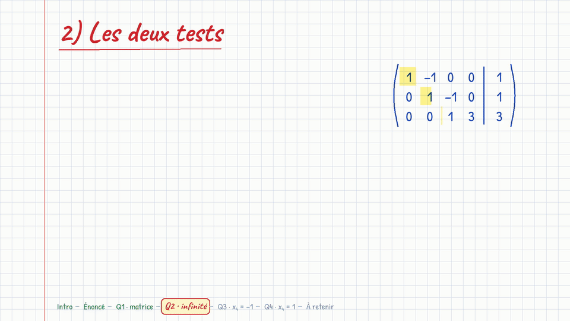
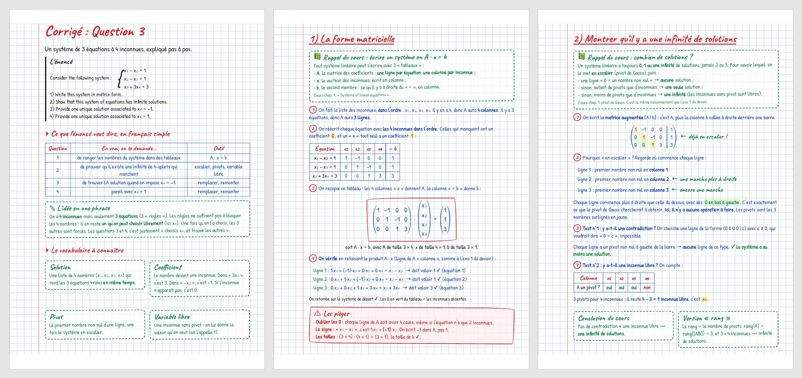
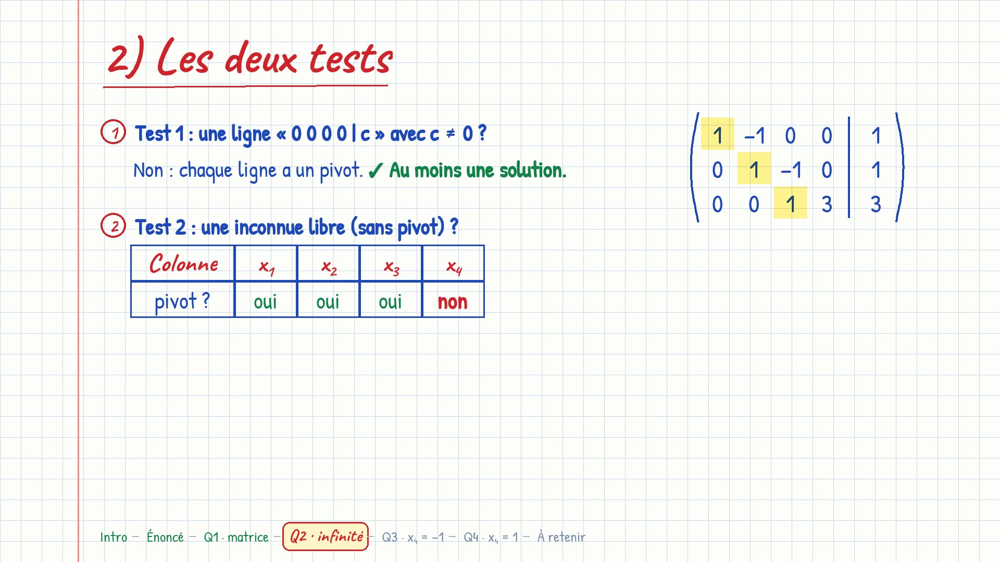

# Math tutor skills for Claude Code

Two [Claude Code skills](https://docs.claude.com/en/docs/claude-code/skills) I made to finally understand my math homework. Paste an exercise, get a worked solution that skips **no** step, in a squared-notebook style, then a narrated video where the page writes itself in sync with the voice.

Everything is in French, because that is how I learn.



## `/math-corrige`: the worked solution

Paste an exercise (text, PDF or picture) and get an A4 PDF that looks like a clean notebook page:

- what the question really asks, in simple words, before any calculation
- a reminder of the course before each method, numbered steps, one operation per line
- every number checked with **sympy** before it is written
- a final check in the original statement, the real traps, and "what to say at the oral exam"



Files: [`SKILL.md`](math-corrige/SKILL.md) (the method and the writing rules), [`modele.html`](math-corrige/modele.html) (the reference sheet and its CSS), [`build.sh`](math-corrige/build.sh) (PDF with headless Chrome, plus a preview of all pages).

## `/maths-video`: the narrated video

The worked solution becomes a 1080p video, with chapters and subtitles:

- a small Python engine draws the notebook page frame by frame: handwriting fonts, matrices, tables, highlighter, circles, arrows, crossed-out terms
- a natural French neural voice ([edge-tts](https://github.com/rany2/edge-tts)) explains each step, and each element appears **exactly** on the word that says it (`@anchor` in the script)
- a "still" mode renders the last frame of every scene and lists layout problems (text out of the frame, overlaps, missing anchors) before the long render
- a lock makes sure only one render runs at a time



Files: [`SKILL.md`](maths-video/SKILL.md), [`engine/`](maths-video/engine) (`engine.py` components, `voice.py` voice and timing, `render.py` rendering), [`exemple/scenes.py`](maths-video/exemple/scenes.py) (a full example).

## Install

```sh
git clone https://github.com/romanmbarali/math-tutor-skills
cp -r math-tutor-skills/math-corrige math-tutor-skills/maths-video ~/.claude/skills/
python3 -m venv ~/.venvs/maths && ~/.venvs/maths/bin/pip install pillow fonttools imageio-ffmpeg edge-tts sympy
export PY=~/.venvs/maths/bin/python
```

Needs Google Chrome (for the PDF) and `pdftoppm` (for the previews). Made for macOS.

## License

Code under the MIT license. Fonts: [Patrick Hand](https://fonts.google.com/specimen/Patrick+Hand) and [Caveat](https://fonts.google.com/specimen/Caveat), SIL Open Font License.
